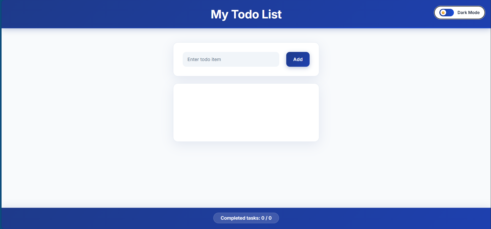
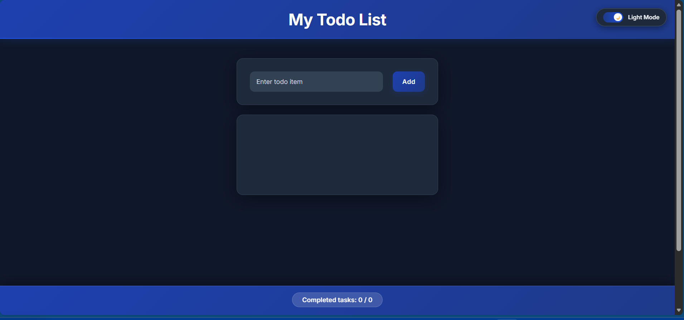

# Todo List App — React Training Project

<div align="center">


A responsive and polished Todo List application built as part of my React practice and skill refresh.

[Live Demo](#) • [Report Bug](https://github.com/developer-abdiweli-jama/TodoApp/issues) • [Request Feature](https://github.com/developer-abdiweli-jama/TodoApp/issues/new?template=feature_request.md)

</div>

---

## About the Project

This app was built to sharpen my React understanding and practice modern UI patterns. I focused on clean components, simple state management, and a smooth user experience. The app supports dark/light mode, looks great on all screen sizes, and includes essential task-management features.

---

## Features

* Add, delete, and complete tasks
* Tasks persist in the browser — a refresh no longer wipes your list
* Dark and light mode with saved user preference, applied before first paint (no flash)
* Fully responsive layout
* Navy blue themed UI with soft gradients
* Completion counter in the footer
* Unfinished tasks automatically appear first
* Empty and whitespace-only tasks are rejected
* Keyboard accessible: every action works with Tab, Space, and Enter
* 35 automated tests covering the behaviour above

---

## Getting Started

### Requirements

* Node.js 18+
* npm or yarn

### Installation

```bash
git clone https://github.com/developer-abdiweli-jama/TodoApp.git
cd TodoApp
npm install
npm run dev
```

Open your browser at `http://localhost:5173`.

### Available Scripts

| Command | Description |
| --- | --- |
| `npm run dev` | Start the dev server with hot reload |
| `npm run build` | Build for production into `dist/` |
| `npm run preview` | Preview the production build locally |
| `npm run lint` | Run ESLint over the project |
| `npm test` | Run the test suite once |
| `npm run test:watch` | Run the test suite in watch mode |

---

## Tech Stack

* React 19.2.0
* Vite 7
* CSS Modules
* Modern JavaScript (ES6+)
* Local Storage for task and theme persistence
* Vitest + Testing Library for tests
* Responsive layout using Grid and Flexbox

---

## Folder Structure

```
TodoApp/
├── index.html
├── public/
│   └── favicon.svg
├── src/
│   ├── lib/
│   │   ├── storage.js      # Safe localStorage read/write helpers
│   │   ├── theme.js        # Theme preference persistence
│   │   └── todos.js        # Todo model, creation and persistence
│   ├── components/
│   │   ├── Form.jsx
│   │   ├── Header.jsx
│   │   ├── TodoItem.jsx
│   │   ├── TodoList.jsx
│   │   ├── Todo.jsx
│   │   ├── Footer.jsx
│   │   ├── ThemeToggle.jsx
│   │   └── *.module.css
│   ├── test/
│   │   ├── setup.js
│   │   ├── app.test.jsx
│   │   ├── todo.test.jsx
│   │   └── storage.test.js
│   ├── assets/
│   ├── App.css
│   ├── App.jsx
│   └── main.jsx
├── eslint.config.js
├── vercel.json
├── vite.config.js
├── package.json
└── README.md
```

---

## Design Notes

* Functional components using React hooks
* Reusable, focused components
* Mobile-first CSS with scalable typography
* Semantic markup and keyboard-friendly interactions
* Stable task ids, so tasks with identical names stay independent
* Light bundle and optimized re-renders

---

## How It Works

### State Handling

* Local state via `useState`, owned by `Todo.jsx`
* Handlers passed down as `onAdd`, `onToggle`, and `onDelete`
* State updates use functional updates, so rapid clicks never read stale state
* Tasks and theme are mirrored to `localStorage` and restored on load
* Corrupted or malformed stored data is discarded instead of crashing the app

### Theme System

* Theme switching based on CSS variables
* Saves user preference automatically
* Smooth transitions on toggle
* An inline script in `index.html` applies the saved theme before first paint

### Responsiveness

* Scales well across phone, tablet, and desktop
* Uses `clamp()` for typography
* Breakpoints for tablet (768px) and mobile (480px)

---

## Using the App

**Add a task:** Type and hit Enter or click “Add”. Empty input is rejected.
**Complete a task:** Click the checkbox or the task text, or focus the checkbox and press Space.
**Delete a task:** Click the “x” button.
**Switch theme:** Use the toggle in the header.




---

## Testing

```bash
npm test
```

The suite runs on Vitest with jsdom and Testing Library. It covers task creation and
validation, duplicate task names, toggle and delete targeting, completion counting,
sort order, persistence, corrupted-storage recovery, and theme handling.

---

## Deployment

The app lives at the repository root, so it deploys as a standard Vite project with no
extra configuration. `vercel.json` pins the framework, build command, and output
directory so the build is deterministic.

### Vercel

| Setting | Value |
| --- | --- |
| Root Directory | `.` (repository root) |
| Framework Preset | Vite |
| Install Command | `npm install` |
| Build Command | `npm run build` |
| Output Directory | `dist` |

Connect the repository to Vercel and every push to `main` deploys automatically.

### Any other static host

```bash
npm install
npm run build
```

Publish the generated `dist/` directory. On Netlify or Cloudflare Pages the Vite preset
is detected automatically; on GitHub Pages set the publish directory to `dist`.

> **Note:** the app must stay at the repository root. If it is nested in a subdirectory,
> the build and output directories have to be set explicitly, and a misconfigured output
> directory serves the repository instead of the app — which returns a 404.

---

## What I Learned

* Building UI with reusable components
* Managing state without external libraries
* Modern CSS features (variables, gradients, transitions)
* Creating responsive layouts
* Improving app performance
* Testing layouts across browsers
* Why stable list keys and identity-based updates matter in React

---

## Future Ideas

* Drag and drop for task ordering
* Categories or tags
* Reminder and due-date system
* Search and filters
* Backend storage (API)
* User accounts

---

## Contributing

Suggestions are welcome.

1. Fork the repo
2. Create a new branch
3. Commit your changes
4. Push the branch
5. Open a pull request

---

## License

This project is under the MIT License.

---

<h2>Contact</h2>
<p><strong>Abdiweli Jama</strong></p>
<p>
  <a href="https://www.linkedin.com/in/abdiweli-jamac-60ab44207" target="_blank">
    LinkedIn Profile
  </a>
  <br>
  Email: <a href="mailto:abdiwelijamac@gmail.com">abdiwelijamac@gmail.com</a>
</p>

<p>
  <strong>Project Repository:</strong><br>
  <a href="https://github.com/developer-abdiweli-jama/TodoApp" target="_blank">
    github.com/developer-abdiweli-jama/TodoApp
  </a>
</p>


---

<div align="center" style="margin-top: 20px;">
  <p>⭐ If this project was useful, consider giving it a star.</p>
  <p>Built with ❤️ as a learning project.</p>
</div>
